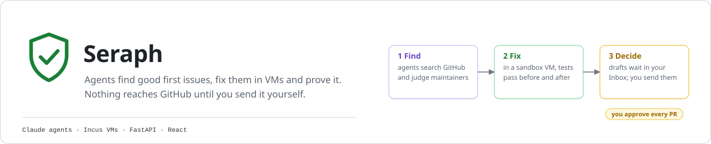
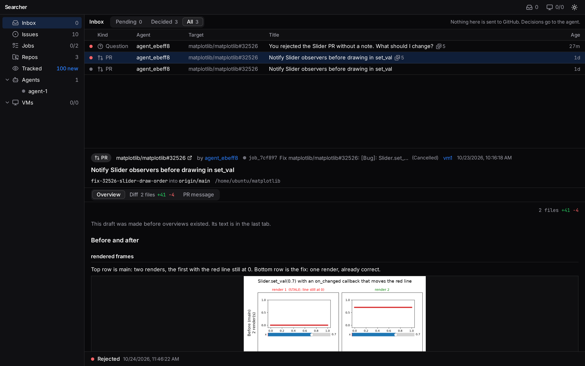
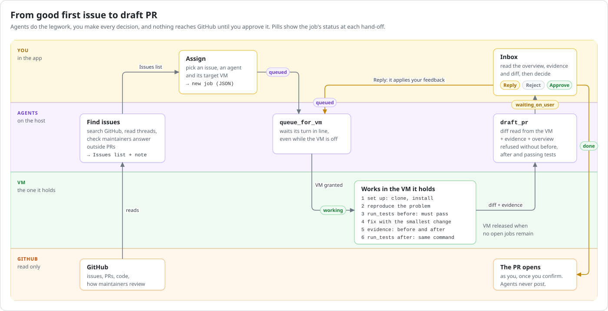
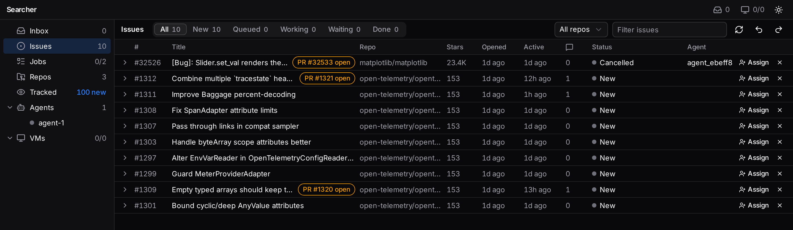
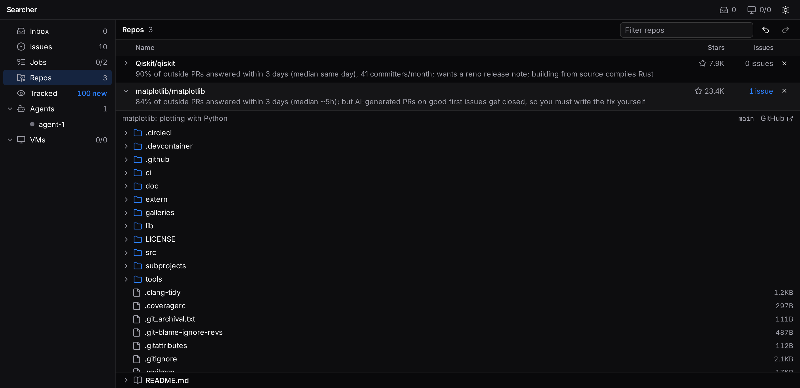
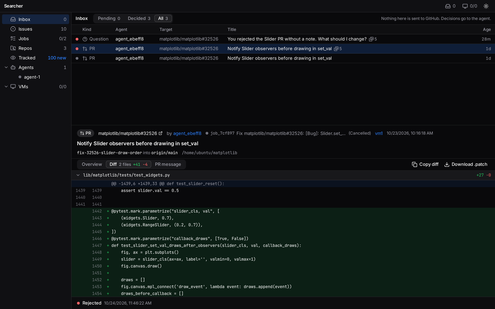
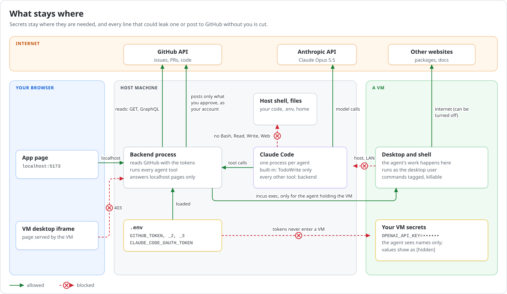
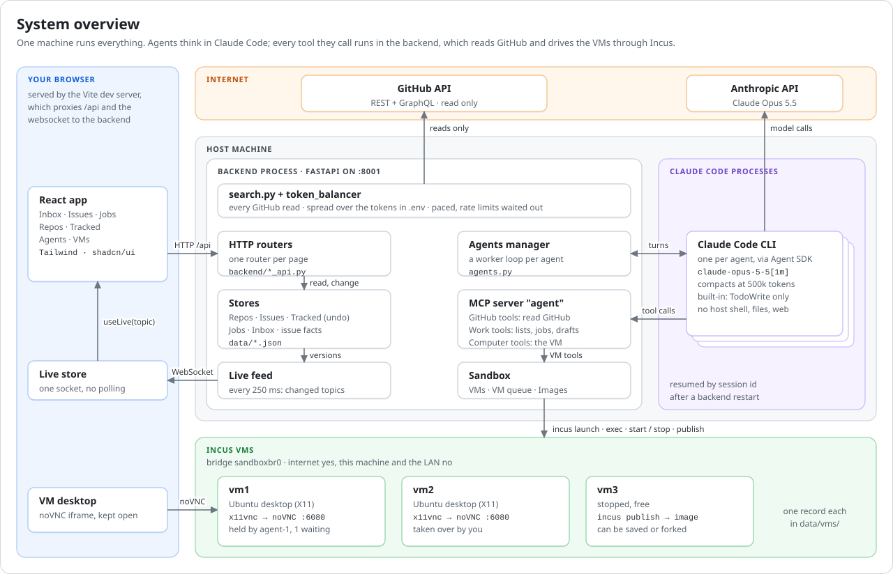

<p align="center">
  
</p>

<p align="center">
  
  
  
  
  
  
</p>

<p align="center">
  <a href="#quick-start">Quick start</a> ·
  <a href="#how-it-works">How it works</a> ·
  <a href="#features">Features</a> ·
  <a href="#safety">Safety</a> ·
  <a href="docs/architecture.md">Architecture</a>
</p>

<p align="center">
  
</p>

GitHub Searcher is a local workbench for contributing to open source with AI agents, without handing them the keys.

Agents search GitHub for good first issues that are worth doing, and check how fast each project's maintainers answer outside contributors. They set each issue up in a sandbox VM, reproduce the bug, fix it, and back the fix with test runs and before-and-after evidence. Every PR, comment and question lands in your **Inbox** as a draft. The app never posts to GitHub: you read each draft, decide on it, and send it yourself.

> **Why a human in the loop?** Maintainers notice drive-by AI pull requests. One agent's note on matplotlib, as it appears in the app: *"AI-generated PRs on good first issues get closed, so you must write the fix yourself."* This tool does the legwork and leaves the judgement, and the name on the PR, to you.

## Features

- **Agents that do the research.** They search repos and issues, read threads and code, and check maintainer activity (time to first reply, time to merge, whether an issue is already taken) before recommending anything.
- **Lists with a memory.** Repos, Issues and Tracked lists, each entry with the agent's note on why it was picked. Undo and redo also cover changes the agents made. Each issue shows live facts from GitHub: assignees, linked PRs, last activity.
- **Tracked repos.** Watch projects you like. Their open issues are checked every 10 minutes, and new ones are flagged.
- **Jobs you can follow.** Each job moves through *understand → set up → reproduce → fix → test → draft*, with a plain-words headline of where it stands.
- **Real sandboxes.** Every VM is a full Ubuntu desktop under Incus/KVM, shown live in the browser. Agents use its shell, mouse and keyboard, so they can run GUIs, browsers and Blender as well as tests. Each VM has its own internet switch, its own secrets, live CPU/RAM/disk/traffic stats, and can be saved as an image or forked.
- **A shared VM queue.** VMs aren't tied to repos or agents. Agents line up for them, and you can take a VM over, hand it to an agent, reorder the line, or remove an agent.
- **Proof before a PR.** The project's full test suite must pass on the unchanged code and again after the fix, with the same command. A PR draft is refused without before-and-after evidence: screenshots, images from the VM, or command runs.
- **One Inbox for every decision.** A plain-words overview, the evidence side by side, the diff and the PR message. **Approve**, **Reply** (the agent applies your feedback and drafts again) or **Reject**.
- **Fast UI.** A Proxmox-style sidebar and one websocket with no polling. Long lists render only the rows on screen, and there are light and dark themes.
- **Rate limits handled.** GitHub requests are spread over as many tokens as you give it, paced, and retried when a rate limit clears.

## How it works

<p align="center">
  
</p>

1. **Find.** You chat with an agent ("find good first issues in Python CLI tools"). It searches GitHub and fills the Repos and Issues lists, each with a note.
2. **Assign.** You pick an issue, an agent and a VM. That makes a **job**, the smallest unit of work, stored as JSON.
3. **Queue.** The agent lines up for its VM. When the VM is its turn, the agent does all of its jobs there, then releases the VM.
4. **Fix and prove.** In the VM it clones the repo, reproduces the problem, runs the tests before and after the fix, and captures evidence.
5. **Decide.** The draft waits in your Inbox. Reply and the agent keeps working. Approve and you open the PR on GitHub yourself.

## Screenshots

<table>
  <tr>
    <td width="50%"><p align="center"><b>Issues</b>: picked by agents, with live facts</p></td>
    <td width="50%"><p align="center"><b>Jobs</b>: steps, notes and drafts</p></td>
  </tr>
  <tr>
    <td width="50%"><p align="center"><b>Repos</b>: browse code in place</p></td>
    <td width="50%"><p align="center"><b>Inbox</b>: review the diff before you send it</p></td>
  </tr>
</table>

## Quick start

### Requirements

- Linux with KVM and [Incus](https://linuxcontainers.org/incus/) 6+ (developed on Fedora)
- [uv](https://docs.astral.sh/uv/) (Python 3.11+) and Node.js 22+
- A Claude subscription for Claude Code: get a token with `claude setup-token`
- One or more GitHub tokens. Read access to public repos is enough, and tokens from different accounts add up.
- Memory and disk: each VM takes 4, 8 or 16 GB of RAM (8 GB is always kept free for the host). The base image is about 11 GB, and each VM disk is 30 to 500 GB (48 GB by default).

### 1. Prepare Incus (once)

<details>
<summary>Network, firewall rules and profile for the sandbox VMs</summary>

```bash
# Incus and KVM (Fedora; use your distro's packages elsewhere)
sudo dnf install -y incus incus-agent qemu-kvm edk2-ovmf
sudo systemctl enable --now incus.socket incus.service
sudo usermod -aG incus-admin "$USER"   # then log out and back in

# A storage pool, and a NAT bridge for the VMs
incus storage create default dir
incus network create sandboxbr0 ipv4.address=auto ipv4.nat=true ipv6.address=none

# VMs reach the internet, but not this machine or your local network
incus network acl create sandbox-egress
incus network acl rule add sandbox-egress egress action=reject \
  destination=10.0.0.0/8,172.16.0.0/12,192.168.0.0/16,169.254.0.0/16,100.64.0.0/10,0.0.0.0/8,127.0.0.0/8,224.0.0.0/4,240.0.0.0/4
incus network set sandboxbr0 security.acls=sandbox-egress \
  security.acls.default.egress.action=allow security.acls.default.ingress.action=allow

# The profile every VM starts with
incus profile create sandbox
incus profile device add sandbox root disk path=/ pool=default
incus profile device add sandbox eth0 nic name=eth0 network=sandboxbr0

# With firewalld: let Incus manage the bridge
sudo firewall-cmd --permanent --zone=trusted --change-interface=sandboxbr0 && sudo firewall-cmd --reload
```

</details>

### 2. Configure

```bash
cp .env.example .env
```

Fill in `GITHUB_TOKEN` (plus `GITHUB_TOKEN_2`, `_3`, … if you have more) and `CLAUDE_CODE_OAUTH_TOKEN`. The defaults are fine for everything else.

### 3. Build the base image

```bash
sandbox/image/build.sh        # about 45–60 minutes: Ubuntu desktop + dev tools
```

You can also start a build from the app: **VMs → Images → Build**.

### 4. Run

```bash
./run.sh
```

Open **http://localhost:5173**. Then:

1. **VMs → New VM** (8 GB is a good start).
2. **Agents → New agent**, set its VM, and ask it to find some good first issues.
3. In **Issues**, press **Assign** on one you like, and watch the job in **Jobs** and on the VM's desktop.
4. Decide on its drafts in the **Inbox**.

## Configuration

Everything is set in `.env`; [.env.example](.env.example) lists every option.

| Variable | Default | What it does |
|---|---|---|
| `GITHUB_TOKEN`, `GITHUB_TOKEN_2`, … | | GitHub tokens; requests are spread over all of them |
| `CLAUDE_CODE_OAUTH_TOKEN` | | Claude Code token (`claude setup-token`) |
| `CLAUDE_MODEL` | `claude-opus-5-5[1m]` | The model every agent uses |
| `AGENT_CONTEXT_CAP` | `500000` | Tokens an agent's conversation holds before it's compacted |
| `BACKEND_PORT` | `8001` | Backend port (the UI is served by Vite on 5173) |
| `DATA_DIR` | `data` | Where lists, jobs, drafts, agents and VM records are kept |
| `SANDBOX_IMAGE` | `base-image` | Image new VMs start from, until you pick a default in the app |
| `SANDBOX_MEMORY_GB_ALLOWED` | `4,8,16` | Memory sizes offered for a VM |
| `SANDBOX_MIN_FREE_RAM_GB` | `8` | RAM always left free for the host |

## Safety

<p align="center">
  
</p>

- **Nothing is posted to GitHub.** The app reads GitHub only. PRs and comments are drafts until you send them yourself.
- **Agents can't touch your machine.** Each agent is a Claude Code process whose only built-in tool is a todo list. Its other tools run in the backend and act on GitHub (read only), the app's lists, or the VM it holds.
- **Tokens never enter a VM.** VM secrets you set yourself reach commands in that VM, but the agent sees only their names: values show as `[hidden]` in output, and a diff that contains one is refused.
- **VMs are fenced off.** They reach the internet but not this machine or your LAN, and their internet can be turned off. The API answers only pages on localhost.

## Architecture

<p align="center">
  
</p>

[docs/architecture.md](docs/architecture.md) walks through all five diagrams, including the data model and the VM queue.

## Project layout

```text
backend/          FastAPI app: one router per page, and the /api/live websocket
frontend/         React + Vite + Tailwind + shadcn/ui
github_searcher/  lists, jobs, inbox, the agents manager, GitHub reads, token balancer
  agent/          one agent: its Claude conversation, system prompt and tools
sandbox/          Incus VMs, the VM queue, images, and the agent's VM tools
  image/          base image build: provision.sh, package list, inventory
docs/             diagrams and screenshots
data/             runtime state, not in git
```

## Development

```bash
uv run serve                          # backend on :8001, reloads on code changes
cd frontend && npm run dev            # UI on :5173
cd frontend && npx tsc -b && npx vite build   # type check and production build
```

Runtime state lives in `data/`. If you delete it, the lists start empty and existing Incus VMs are picked up again.

## Status

An early, single-user project that runs locally. It works end to end on good first issues; reviewing other people's PRs and more job kinds are next.
