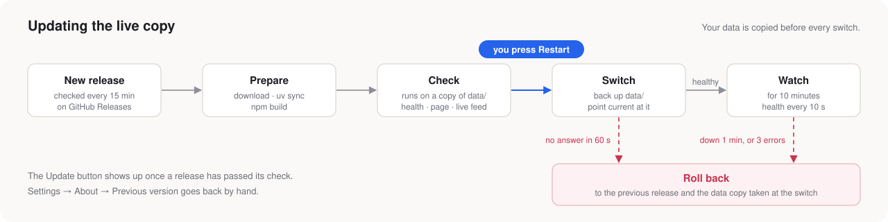

# Seraph

**Agents find and fix GitHub good first issues in sandbox VMs. You decide what reaches GitHub.**


Coding agents on your own Linux machine. They pick issues in projects that merge outside work and fix them on real desktops in VMs. Each change comes to you as a draft, and **Approve** sends it as you. [How it works →](docs/how-it-works.md)

```bash
cp .env.example .env    # GITHUB_TOKEN, CLAUDE_CODE_OAUTH_TOKEN
./run.sh                # http://localhost:5173
```

You need Linux, Incus with KVM, Python 3.14 with uv, and Node 22. [Setup →](docs/setup.md)

## Finding work


[Signals and issue merge →](docs/how-it-works.md#judging-repos)

## The app


[Every page →](docs/app.md)

## Sandbox VMs


[VMs, desktops and images →](docs/sandbox.md)

## Your own repositories


[Development and releases →](docs/own-repositories.md) · [Papers →](docs/papers.md)

## Live copy and updates



```bash
deploy/install.sh v0.1.0    # once
./live.sh                   # the installed release
./run.sh                    # your working code, same data and VMs
```

[Live copy →](docs/live-copy.md)

## More

[Security](docs/security.md) · [Remote access](remote_access/README.md) · [Development](docs/development.md)
