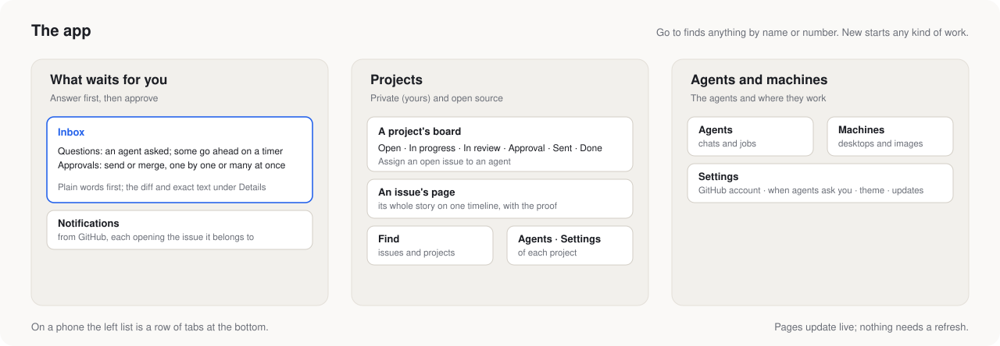

# The app

## Home

| Page | |
|---|---|
| **Explore** | Set how many repos to find and how many workers to run, then **Start**. You **Approve** each find into Repos, or **Remove** it. **Profile** says what you're after. |
| **Repos** | Every signal is a sortable column. **Set up** has an agent clone a repo into a VM and leave it running for you to try. |
| **Tracked** | New issues from repos you watch. **Add to Issues** adds the free ones. |
| **Issues** | **Assign** gives an issue to an agent. Issues being worked on show their progress in the sidebar. |
| **Jobs** | Open, queued, working, waiting, done or cancelled, each with its steps, notes and drafts |
| **Agents** | Each agent has a chat, a live view of its desktop, its jobs, and its **Artifacts** (files it keeps) |
| **VMs** | Each VM's desktops, line of agents, notes and usage. **Images** and **Defaults** are tabs here. |
| **Resource** | This computer's CPU, memory, GPU, disk, network and battery, and what each VM uses |

## GitHub

These pages read GitHub with your own sign-in. Every button that changes something asks first.

| Page | |
|---|---|
| **Overview** | Inbox, Notifications, Your repositories, Pull requests and Agents on one page |
| **Inbox** | Drafts waiting for you: see [the Inbox](how-it-works.md#the-inbox) |
| **Notifications** | GitHub's own notifications |
| **Pull requests**, **Issues** | Yours, on other people's projects, with the full thread: reviews, code comments, checks, commits and files. Each thread's agent mode is **Drafts** or **Off**. |
| **Tasks** | Agent work grouped by issue: the issue, the work, the drafts, the pull request |
| **Your repositories**, **Starred** | Code, Issues, Pull requests, Commits and Actions |
| **Account** | **Sign in with GitHub**, or **Use a token instead** |

## Workspace

| Page | |
|---|---|
| **Home** | Your repositories. A repo's page adds **Agents**, **Development** and **Releases**: see [your own repositories](own-repositories.md). |
| **Pull requests** | Created by me, Assigned to me, Mentioned, Review requests |
| **Papers** | **Add paper**: see [papers](papers.md) |

## Settings and phone

- **Settings** holds the theme and accent color, environment variables for all VMs, [remote access](../remote_access/README.md), and **About**, which has **Check for updates** and **Previous version**.
- **On a phone.** Below 768 px wide, one **Menu** drawer holds all three tabs. A VM page lets you take over a desktop, with an on-screen bar for Esc, Ctrl, Alt, Tab and the arrow keys.
