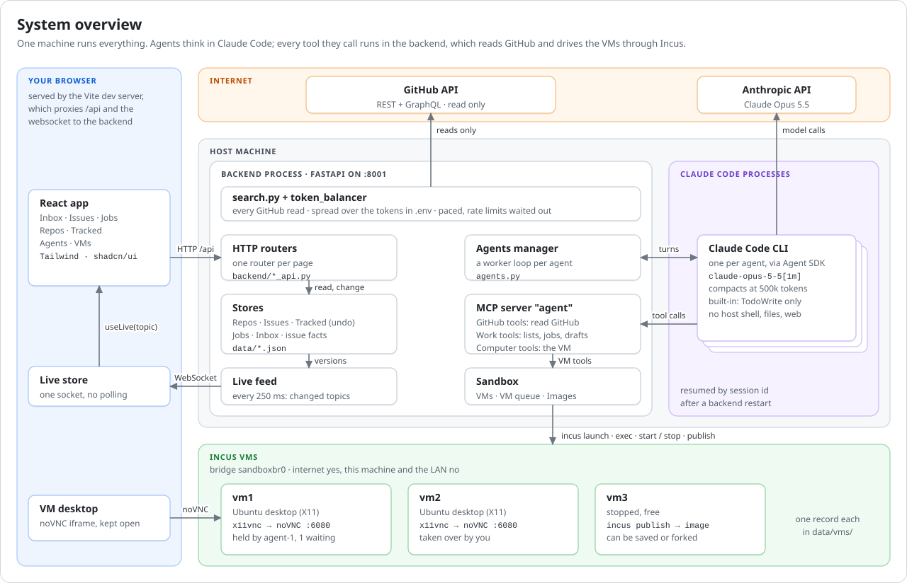
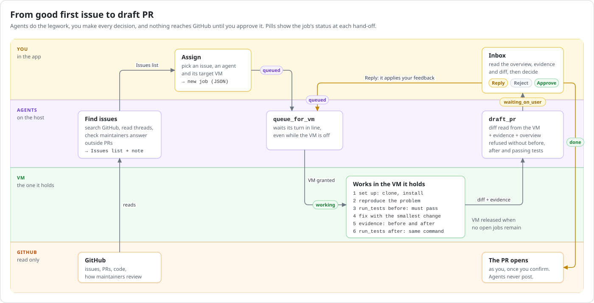
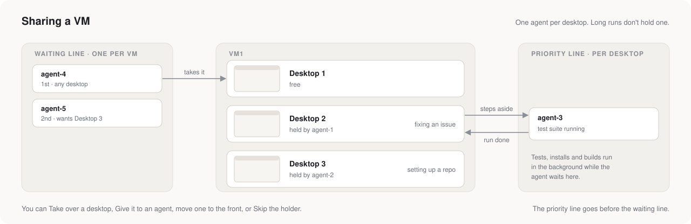
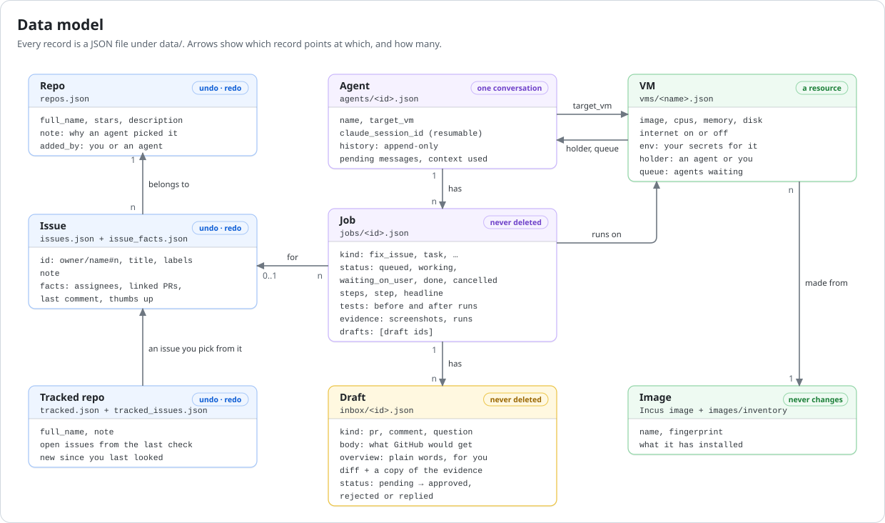
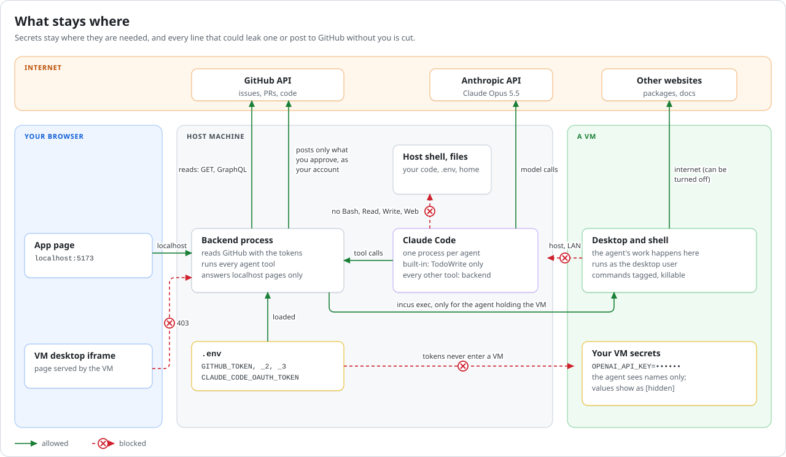

# Architecture

Seraph is a harness for finding and fixing GitHub good first issues, with a human in the loop.
Agents search GitHub, keep the lists and do the hands-on work in sandbox VMs. Nothing reaches GitHub until you approve it.

The diagrams are SVG files in this folder and follow your light or dark theme.

## System overview



- **Browser:** the React app gets all its data over one websocket (`/api/live`). Every 250 ms the backend sends only the topics whose version changed, so the page never polls.
- **Backend:** one Python process (`backend/app.py`) owns the stores (`data/*.json`), the agents manager (`github_searcher/agents.py`) and the sandbox managers (`sandbox/`).
- **Agents:** each agent is its own Claude Code process. Its only built-in tool is TodoWrite. Every other tool it calls is served by the in-process MCP server "agent", so those tools run in the backend, not in Claude Code.
- **GitHub:** agents and searches only read. Every such request goes through `token_balancer.py`, which spreads requests over the tokens in `.env` and waits out rate limits. The one writer is Approve in the Inbox: it sends a PR or comment with your own account's token (`github_searcher/github_account.py`, from Sign in with GitHub on the GitHub tab under Account), never the search tokens. The GitHub tab's buttons (comment as you, close or reopen a PR, delete its branch from your fork, delete one of your comments, push an approved fix onto your open PR, and a maintainer's buttons in your own repositories) use it too, each after an "are you sure?".
- **VMs:** Incus VMs on their own bridge. The backend drives them with `incus`; the browser shows each desktop by loading its noVNC page straight from the VM. The agent page's view-only Desktop connects to the same VNC websocket with noVNC's client library, so it shows only the screen. Through the remote access domain the VM's address can't be reached, so every desktop uses that client library and its VNC websocket passes through the backend (`/api/vms/{name}/vnc`); noVNC's page from the VM never runs on the domain.

## From good first issue to draft PR



- A **job** is the smallest unit of work. You make one by assigning an issue, with Set up on the Repos page, or with New job, and an agent can also make its own.
- **Set up** (`set_up_repo`: understand → set up → show → introduce) has no fix and no draft. The agent reads the README and docs. An app with a clear frontend it sets up and leaves running on the VM's desktop; a server goes in the VM's demo service, so it keeps running after the agent lets go of the VM and after a restart. A library or other low-level repo it clones and opens in VS Code. Then it writes a short introduction to the repo, in its chat and in the job's notes.
- First the agent reads the project's rules for contributors (`contributing_guide`): every CONTRIBUTING file in any folder, developer guides in the docs, the PR template, AGENTS.md, and the guides the README and CONTRIBUTING link to, in the repo or on the project's website. `run_tests` and `draft_pr` refuse until it has.
- In the VM, it runs whatever the project's rules ask to run before a PR (its official checks), however long they take, or else the tests that cover the change (the basic checks). They must pass **before** it changes anything and again **after** the change, with the same command. The job and the Inbox say which ran.
- A project already set up in the VM isn't set up again: a passing full-suite run from an earlier job on the same repo and VM counts for the next one.
- `draft_pr` is refused without before/after evidence and both passing test runs.
- Evidence pictures are real screenshots of the project running on the VM's desktop (its window, or a terminal running it) and screen recordings; never charts or images the agent drew (`evidence_add` refuses matplotlib images).
- A PR is written from the project's rules and its recently merged PRs: the agent must read its main contributors' latest merged PRs first (`pr_examples`). No draft has emoji. Every commit is the agent's own: `draft_pr` refuses a branch with anyone else's commits or a Co-authored-by line. The before/after screenshots go in the PR body; the Inbox shows them in place. Sending uploads them to your fork's `pr-pictures` branch and links them there (Copy picture and Download are for sending by hand).
- What the agent does in the VM is meant to be watched: it runs the app on the desktop where it can, and test runs and other long commands show live in a terminal window there.
- **Redraft** sends the job back to the agent with your notes, **Discuss** talks it over in the agent's chat while the draft waits, **Edit** changes its title or text before you approve. **Reject** tells it to change course or cancel. **Approve** marks it done. Signed in with GitHub, it first asks "are you sure?", then opens the PR as you: the agent's commits replayed on the commit it started from (their messages, all with your name), on a new branch in your fork, into the branch the agent started from. What goes out ends at exactly the diff you reviewed, rebuilt on the host from GitHub's copy of the files, never read from the VM again; anything uncommitted goes in one last commit. The draft keeps what was sent (`sent`: the PR's link, number, fork, branch and commit). Not signed in, Approve sends nothing and you open the PR yourself.
- The **GitHub** tab follows every PR you sent, from the app or by hand, and the issues and PRs you opened or commented on, on other people's projects (`github_searcher/pr_tracking.py`, read with the search tokens every few minutes and right after a send): its state, its checks (including runs that wait for a maintainer to approve them, as GitHub does for a first-time contributor), reviews, the latest comment, and the issues it fixes. Opening one reads all of it from GitHub at once: the conversation, reviews with their code comments, commits, checks and files changed.
- **Your repositories** on the GitHub tab are every repo you can push to, public and private, **Starred** the repos you starred (Star and Unstar on each repo's page), and **Notifications** are GitHub's own (`github_searcher/your_repositories.py`, `github_searcher/notifications.py`). Both are read with your sign-in, not the search tokens, since those can't see private repos; so is a thread in one of your repositories. There you act as a maintainer (review, merge, close, label, assign, edit, re-run failed checks), each after an "are you sure?". The **Overview** puts what waits for you from all of these on one page, and **Tasks** ties each issue to its jobs, drafts and PR, so one line per piece of work shows how far it got.
- Each followed PR or issue has an agent setting, **Drafts** or **Off** (no fully automatic mode). With Drafts, when someone other than you (not a bot) writes there last, or a PR's checks fail on a new commit, its agent gets a **follow_up** job: it reads the thread and drafts a reply (`draft_comment`), or fixes the PR on its own branch in the VM and drafts the new version (`draft_pr` with `pr`), or ends the job when nothing needs an answer. Approving a new version pushes its commits onto the PR's branch in your fork (never a force push; refused when the branch moved since) and posts its comment. A PR or issue the app sent something to (a PR, a comment) starts with Drafts on, followed by the agent that drafted it; everything else starts Off.
- If an issue an agent has a job for goes from free to assigned (someone else is on it now), the app puts a **Taken** item in the Inbox: **Keep working** lets the agent go on, **Stop the agent** cancels the job and stops it right away. The agent never stops for it on its own.

## Who holds a VM



- VMs aren't tied to repos or agents. Each one keeps a holder and a line of waiting agents (`sandbox/vm_queue.py`), saved with the VM, so both survive a restart.
- Each VM also keeps notes on what is set up in it (`sandbox/vms.py`), written by the agent holding it and by you. Agents see them when they pick a VM and again when it becomes theirs; a fork starts with its source's notes.
- An agent uses VM tools only while it holds its target VM. Once it gets the VM, it does all its jobs there, then releases it.
- Long commands (a test suite, a big install or build) are runs (`sandbox/agent/long_runs.py`): they go on in the VM by themselves, in a terminal window on its desktop. The agent starts one in the background, or it moves there after 10 minutes. When all the agent does in the VM is wait for its run, it steps aside: the next agent gets the VM, and it waits in the VM's priority line. The priority line comes before the waiting line: when the VM is free, its first agent whose run is over gets it, and one whose run still goes moves to the end of the priority line. The run's result comes with the message that the VM is the agent's again.
- When you take a VM away, skip the holder (Skip: it steps aside the same way) or remove an agent from a line, that agent is interrupted, and every command it started in the VM is killed, except its runs. The VM page lists the runs going, and Stop ends one.

## Data model



- The Repos, Issues and Tracked lists have undo/redo, which also undoes changes agents made. GitHub facts about issues and tracked repos are kept in separate files, so undo never brings back old facts.
- Jobs are never deleted. When an agent is deleted, its open jobs become cancelled. Drafts stay in the Inbox until you delete them, and only decided ones can be deleted.
- How each of your PRs stands is kept in its own file (`data/pr_tracking.json`), linked to the draft it was sent from.
- Incus is the truth for VMs: an Incus VM without a record gets one again.

## What stays where



- The GitHub and Claude tokens stay on the host. They never enter a VM. Agents and searches read GitHub with the search tokens only. Your account's token (from Sign in with GitHub, kept in `data/github_account.json`, readable by you only) sends what you approve and does what you click on the GitHub tab, and reads only what the GitHub tab shows you of your own repositories and notifications; the browser and agents never get it.
- A VM's own secrets (set in its Settings tab) reach commands in the VM. The agent sees only their names: any value that shows up in output reads `[hidden]`, and a PR diff that contains one is refused.
- A VM can reach the internet but not this machine or the LAN. The API answers only pages on localhost, so a VM's desktop page gets 403.

## Remote access

Once it is set up ([remote_access/README.md](../remote_access/README.md)), the app also opens at your own address, from any device:

```text
device ──► your address ──► forwarder ◄── SSH, opened from this computer ──► Caddy (127.0.0.1) ──┬─► /api/* : backend
                            (small server,                                   holds the            └─► the rest: Vite, after
                             only SSH)                                       certificate                GET /api/remote_access/check
```

- The forwarder passes the address's ports 443 and 80 back through the SSH connection that this computer keeps open. TLS ends at Caddy on this computer, so the forwarder sees only encrypted traffic. Its tunnel key may open those two ports and nothing else.
- Every request through the address needs a passkey session: the backend checks every API call and the live websocket (a request counts as through the address when its Host is the address or it carries X-Forwarded-For, which Caddy adds), and Caddy asks it before passing on the app's own files. Only the Sign in and Add this device pages are open.
- Devices are added only on this computer, with a one-time link (Settings → Remote access → Add a device). Remove signs a device out at once, including its open live feed. The passkeys' public keys and the sessions (only their hashes) are in `data/remote_access.json`. The tunnel key, the server's fingerprint and the certificate are in `data/remote_access/`.

## Live copy and updates

`deploy/install.sh` makes a live copy of the app in `~/seraph`, apart from the folder you edit (the dev copy, `./run.sh`):

```text
~/seraph/
├── current -> releases/v0.1.0    the release that runs (the user service seraph starts it)
├── releases/<tag>/               a release: its code, .venv, its built page, VERSION; any of them can be deleted and got again
├── backups/<time>-<tag>/         data/ as it was before each switch (the last 10)
├── data/                         yours, the same for every release
└── .env
```

- The live copy's backend doesn't reload on code changes, and serves its own built page at `/` (no Vite). Its version is the release's tag (`VERSION`); the dev copy's is `dev`, and it has no updates.
- `github_searcher/updates.py` asks GitHub for the latest release of `SERAPH_REPO` every 15 minutes, with your GitHub sign in. A newer one is made ready in the background: its code from GitHub's archive, `uv sync`, `npm ci` and `npm run build`. Nothing restarts by itself: **Update** in the header shows it.
- **Restart** waits for a moment when no agent is in the middle of a tool call (at most a minute), then runs `deploy/switch.sh` outside the app with `systemd-run`: stop the app, copy `data/` to `backups/`, point `current` at the release, start it, and wait for `/api/health`. A release that doesn't answer within a minute: `data/` and `current` go back, and the release before starts again.
- What a restart doesn't touch: VMs and their runs (Incus), the VM queue (saved with the VMs) and the agents' conversations (Claude Code keeps them by the path of `data/agent_home`, which stays the same). An agent's turn that is cut off carries on after the restart, as after any restart.
- Open pages notice another version on the live feed (topic `updates`) and reload at the same place: the page is in the URL.
