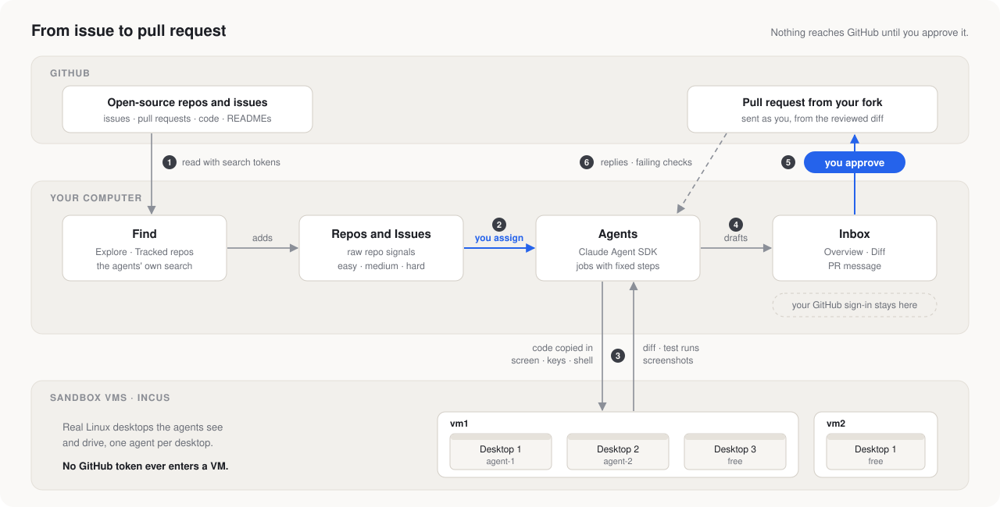
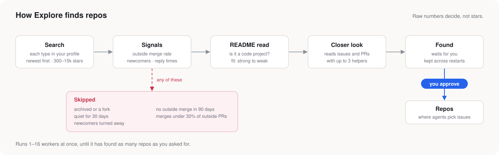

# How it works

1. **Find.** Explore searches GitHub for repos that fit your profile. Tracked repos are checked for new issues every 10 minutes. The agents also search on their own.
2. **Assign.** You give an issue to an agent. It picks a VM, or you pick one for it, and waits in line for a desktop.
3. **Fix in a VM.** Every fix goes through the same steps: *understand → set up → reproduce → fix → test → draft*.
   - The project's own checks pass on the unchanged code first, then on the exact code being drafted.
   - The evidence is real screenshots of the project running.
4. **Review.** A reviewer agent checks every PR draft first, the way the project's maintainers will: every point the issue or a reviewer asked for, and the edge cases of its kind. Only then it lands in the Inbox. It has an **Overview** in plain words, with a **Checklist** of every point asked (what isn't done comes first) and what was **Also tested**, the **Diff**, and the **PR message** written to the project's contributing guide.
5. **Send.** Approve rebuilds the change on your computer, pushes it to a new branch in your fork, and opens the pull request as you.
6. **Follow up.** Every open PR of yours has an agent that owns it, and it hears about every change there: replies, reviews, checks, pushes, conflicts with main, labels, merged or closed. It first reproduces what was reported in a VM, and tests the rest of that kind of mistake too, then drafts the answer (inside a reviewer's conversation on a line of code when that is where they asked), the next version, a rebase, a new title and description, or one of the buttons you would click on GitHub (request a review again, ready for review, convert to draft, allow edits by maintainers, update branch, resolve conversations, close, reopen), and it comes back to the Inbox. Nothing is posted or pushed until you approve it.

## Judging repos

There is no overall score, only the raw numbers. Bots and AI reviewers never count as maintainers.

| Signal | What it measures |
|---|---|
| Outside merge rate | Merged ÷ (merged + closed) for pull requests from outside the project, last 90 days |
| First reply | Median days until a human maintainer answers an outside PR |
| Time to merge | Median days from opening to merge |
| Stale outside PRs | Open over 30 days with no maintainer reply |
| Newcomers | *welcomes*, *ok*, *few*, *left waiting* or *turned away* |
| Active mergers | People who merged PRs in the last 30 days |
| Activity | PRs, issues and commits per month, trend up, down or flat |
| Review tone | *warm*, *neutral*, *strict* or *curt*, and what reviewers ask for |
| AI policy | *welcome*, *disclose*, *no AI*, *unclear* or *none* |

## Issue merge

How hard the code is doesn't decide much: the agent writes hard code. What matters is whether the PR gets merged. The agent answers yes or no to six checks about each issue: it belongs in this repo, it can be seen on Linux, it is free of politics, it is open to outside contributors, it is a modest change, and the fix can be proven in a VM. A fixed rule turns those answers, the issue's status, the repo's numbers and your merged PRs there into **Merge**: the first row that holds.

| Merge | Rule |
|---|---|
| **Fixed** | Still open on GitHub, but a merged PR or a commit already does what it asks (the PR said "Addresses #n" instead of "Fixes #n"). It only needs closing. |
| **Out of scope** | It is a plugin or add-on for a third-party product's users, the project wants it as a separate repo, it can only be seen on macOS, Windows, a phone or special hardware (even when its files can be edited on Linux), or it is political. |
| **Claimed** | Someone else is on it |
| **Maintainers only** | The maintainers keep it for themselves |
| **Waiting** | It isn't ready to pick up: it needs a decision, a design or more information, or it's a feature request no maintainer has said yes to |
| **No outside PRs** | The repo doesn't merge outsiders' PRs: its AI policy says no AI, most newcomers' first PRs are closed or left waiting, or none of its recent outside PRs was merged |
| **Large feature** | A new subsystem, integration or driver the maintainers would have to keep up |
| **Big change** | Over 200 lines while you have no merged PR in that repo yet |
| **Can't validate** | The agent can't prove the fix works in its VM. Long builds and tests are fine. |
| **Likely** | None of the above |

Agents only pick issues whose Merge is Likely. You can assign the others, except Fixed, Out of scope and Can't validate: a job that can't be proven ends with nothing to show. An agent that finds out mid-job that it can't validate a fix cancels the job itself, without asking.

Every issue is also tagged **free**, **assigned**, **waiting** or **fixed**. An issue with a fix already posted in a comment counts as taken. If an issue gets taken while an agent works on it, the agent is told who took it and decides itself: it stops (and says who and why on the job) for a maintainer, a member of the project or someone who often gets PRs merged there, and keeps going for a new or unknown account.

Some repos or issues want you to claim an issue before you start, often with a `/claim` comment. There the agent drafts that claim first, as **Claim owner/name#n** in your Inbox, and goes straight on with the fix without waiting for you or the maintainers. When you come back you find the claim and the PR, to approve in that order: the PR can't be sent before the claim is decided. If the maintainers assign someone else, the agent decides the same way as when an issue gets taken.

Agents never ask maintainers or anyone else on GitHub for anything beyond what the issue or the project's rules ask for, and they assume nobody answers: open choices they decide themselves and explain in the PR.

## The Inbox

| Kind | Tabs | Approve |
|---|---|---|
| **PR** | Overview, Diff, PR message | Opens the pull request as you, pushes a new version to one you already opened, or force-pushes a rebase of it |
| **Comment** | Overview, Comment | Posts it as you |
| **Edit** | Overview, Changes, Title and description | Changes the title and description of your own PR or issue |
| **Action** | Overview, the comment posted with it (if any) | Does it on your own PR or issue: requests a review, marks it ready for review or a draft, allows edits by maintainers, updates the branch, resolves conversations, closes or reopens it |
| **Question** | – | You **Reply**, or pick one of the answers the agent offers |
| **Taken** | – | **Keep working** or **Stop the agent**. Only older ones: agents now decide this themselves |

Agents only ask when it matters; small choices they make themselves and say so on the job. A question with answers to pick from has the one the agent recommends, and waits for you for the time set in **Settings** (10 minutes unless you change it): then the app picks the recommended answer and the agent goes on. A question about money, politics or another sensitive subject, what gets sent to GitHub, or deleting something that can't come back always waits for you, and so does one you answer in your own words. In **Settings** you choose which of those four always wait.

Before you decide, you can edit the text, **Redraft** with a note, or **Discuss** it with the agent. If you approve before signing in, **Send to GitHub** sends it later. **Download .patch** gives you the change as a file instead.

**What Approve sends:**
1. The reviewed diff is applied on your computer, to the project's files read from GitHub. Nothing comes from the VM.
2. The agent's commits are replayed under your name and your noreply email address.
3. Evidence pictures go on a `pr-pictures` branch in your fork.
4. The change is pushed to a new branch in your fork, and the PR is opened from there.
