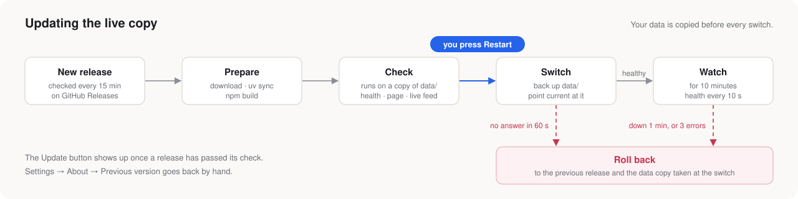

# Live copy and updates



```bash
deploy/install.sh v0.1.0   # once: makes ~/seraph from a release tag, and moves data/ and .env there
./live.sh                  # runs the release at http://localhost:8001, Ctrl+C stops it
./run.sh                   # runs your working code instead, on the same data, VMs and agents
```

- **One copy at a time.** Both copies share the same data, VMs and port, so each script refuses to start while the other runs.
- **No auto start.** The live copy runs as the user service `seraph`, only while `./live.sh` is open. It never starts by itself, not even after a reboot.
- **Backups.** `./run.sh` first copies your data to `~/seraph/backups`, keeping the last 10 copies.
- **Updates.**
  - New releases are prepared in the background and started on a copy of your data, on port `BACKEND_PORT + 2`.
  - **Update** appears only after that check passes, and nothing installs until you press **Restart**.
  - [`deploy/switch.sh`](../deploy/switch.sh) does the switch and the rollback.
