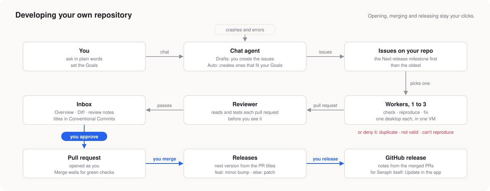

# Your own repositories

Development has no page since the redesign: your private projects are developed through [Workflow](workflow.md). This describes Development as it was; its backend is still there.

- **Chat agent.** In **Drafts** mode, it writes issue drafts for you to create. In **Auto** mode, it creates issues itself, but only ones that fit your **Goals**.
- **Workers, 1 to 3.** A worker checks that an issue is valid and not a duplicate, and reproduces it. Then it fixes it, or denies it with a reason. Workers share one VM, each on its own desktop.
- **Reviewer.** It reads and tests every pull request before the pull request reaches your Inbox.
- **Crashes become issues.** Errors from the backend, the browser, the agents and releases are collected and deduplicated. The chat agent turns them into issues.
- **Releases.** The next version comes from the PR titles: any `feat` makes it a minor bump, otherwise a patch bump. **Release** makes the GitHub release, as you.

On your own repos, agents do some things as you without asking. They create issues in Auto mode, file crash reports, close issues they deny, and update PR branches that fell behind. Opening, merging and releasing are always your clicks.
