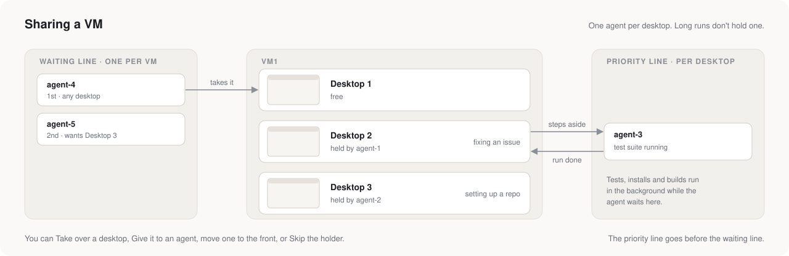

# Sandbox VMs

Agents never run code on your computer. Everything they build, install or run happens in an Incus VM.



- **Desktops.** A VM starts with 1 desktop. Agents add more as they need them, up to its **Max desktops** (5 by default), which you set when you make the VM and can change any time in its Settings.
  - Each desktop has its own Linux user, home folder, screen, browser and demo service.
  - You can watch any desktop in the page, or take it over.
  - Desktops keep their numbers. A new one takes the lowest free number.
- **What agents do there.** They take screenshots, click, type and press keys. They run shell commands, and drive Firefox, which they read as text with numbered elements. They can also lock your mouse and keyboard for a moment.
- **Long runs.** Test suites, installs and builds run in the background, and anything still going after 10 minutes moves there by itself. Meanwhile the agent waits in the priority line instead of holding the desktop.
- **Network.** VMs reach the internet, but not your computer or your local network. You can turn a VM's internet off.
- **Size.** By default a VM gets 8 CPUs, 8 GB of memory (up to 32 GB) and a 128 GB disk. Seraph won't start a VM if that leaves less than 8 GB of memory free.
- **Files.** You push and pull files on a VM's Resources tab. Agents copy files between a VM and their artifacts folder.

## Images

Each image is one `image.yaml`, built from an official Ubuntu, Fedora or Debian image:

```yaml
system: ubuntu-24.04          # Ubuntu 22.04/24.04/26.04, Fedora 43/44, Debian 12/13
desktop: gnome                # gnome, kde or none (terminal only)
packages: [git, ripgrep]      # apt on Ubuntu and Debian, dnf on Fedora
python:
  packages: [pytest, ruff]
node:
  version: 24
  packages: [pnpm]
docker:
  images: [postgres:17, redis:7]
steps:                        # anything the lists can't say: bash, run as root
  - name: Bun
    run: curl -fsSL https://bun.sh/install | BUN_INSTALL=/usr/local bash
```

- **What every image gets.** Seraph's own needs, which are the desktop, Firefox, VNC, the terminal, the user and the demo service, come from [`sandbox/image/base_layer.sh`](../sandbox/image/base_layer.sh).
- **Fast rebuilds.** A build runs in three stages and takes a snapshot after each, so changing a list rebuilds in minutes.
- **Inventory.** Every build lists what it contains.
- **Defaults.** The **Defaults** tab is the list every new image starts from.
- **Image agent.** Each image has a chat agent that edits its `image.yaml` and tries it out in a throwaway VM.
